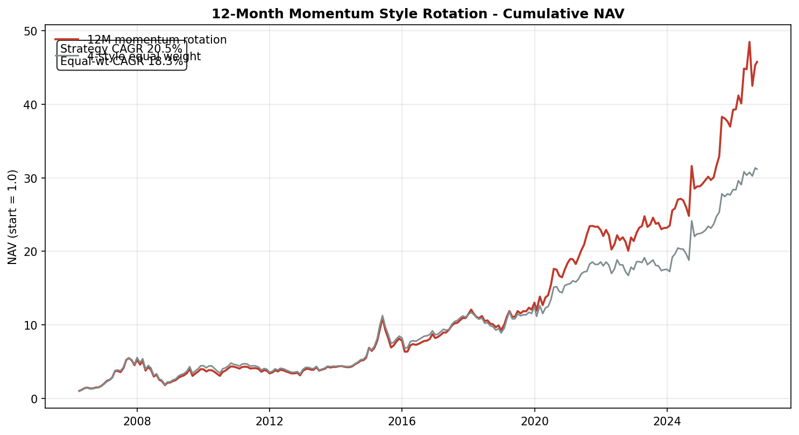

# Quant Allocation Lab

**16 production quant models for China markets — allocation, style rotation, market timing**

8+ years of live buy-side development · Peking University M.Eng. (CS) · Python/pandas

  

---

## Results

### 12-Month Momentum Style Rotation — 20 years, 2006–2026

**CAGR 20.5% vs 18.3% equal-weight** over 20.5 years across four style legs (dividend / growth / quality / value). The term-structure analysis in the model docs shows why 12M is the sweet spot: short horizons (2–3M) mean-revert, 6–12M trends persist. **+4.49% annualized excess vs equal weight, 54.6% win rate, only 7.9% monthly turnover** — statistically clean and cheap to trade.

### Asset-Level Dual Momentum — 2014–2025

**CAGR 22.7%** on an ETF universe (equity / bond / commodity / gold legs), absolute+relative momentum gating with cash fallback. The docstring honestly documents fee drag: 20.6% gross → 16.5–18.9% net after real-world costs, plus limit-up/down handling (which added ~1.9pct/yr, an unexpected finding).

### US 10Y Rate Z-Score Style Rotation — 2014–2026

Three-regime switch (rates falling → growth+quality; rising → dividend+value) driven by an 18-month rolling Z-score of the US 10Y yield. Modest but positive excess vs equal weight, with full regime-by-regime attribution and failure-mode analysis documented inline (2006–07 equity-reform bull and 2009 stimulus broke the US-rate transmission chain — the model tells you when it does NOT work).

### Annual-MA Dividend Timing — conditional entry statistics

Buying a dividend low-vol index **below its 250-day MA** delivered **+16.8% average 1Y return with 94.9% positive rate** (514 samples, 2015–2026) vs +10.4% / 86.1% unconditionally — a counter-cyclical entry rule with full sample counts and caveats.

> **Disclaimer:** All figures are historical backtests on total-return indices. They do not guarantee future returns.

---

## Model Map

| Module | Models | Highlights |
|---|---|---|
| `allocation/` | risk-parity engine | Equal-risk-contribution across equity / 10Y-30Y bonds / commodities / gold |
| `style_rotation/` | 8 models | **Momentum** (12M, 20.5y backtest), **rate Z-score** (3-regime), Pring 6-phase cycle, valuation spread, crowding, pair-switch, alpha-composite, combined |
| `timing/` | 6 models | **Dual momentum** (absolute+relative), **annual-MA rule** (94.9% conditional win rate), gold valuation, LPPLS bubble detection, bond-futures timing, index valuation signal |

Each model file opens with a complete methodology docstring: **hypothesis → indicator construction → signal rules → backtest → known failure modes**, so reviewers can audit the logic without running anything.

## Engineering Principles

1. **Methodology-first docs.** Full reasoning chain inline; Excel-lineage cross-checks where models were first prototyped in spreadsheets.
2. **No look-ahead.** Rolling windows computed as-of; total-return indices wherever dividends matter.
3. **Honest attribution.** Every model documents when it fails (regime breaks, fee drag, turnover costs), not just when it works.
4. **Institutional data hygiene.** Explicit index-code lineage per signal (e.g. h20269.CSI → dividend low-vol total return).

## Data

Models read from a local Wind-derived parquet warehouse (not bundled — institutional data). Adapter layer is isolated in each model's data-loading section; swap in any daily OHLC source to run.

## Author

**Fucheng Dou** — fund manager (index & multi-asset), 9 years buy-side. PKU M.Eng. CS + B.Sc. Physics. Building quant systems and AI-engineered investment workflows.

