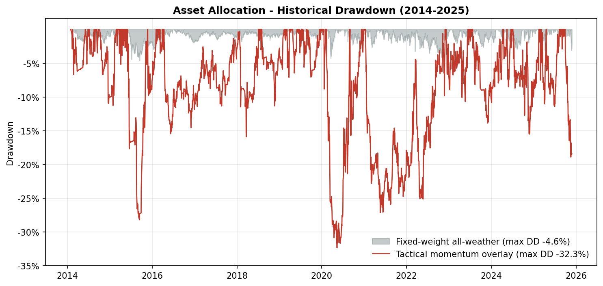
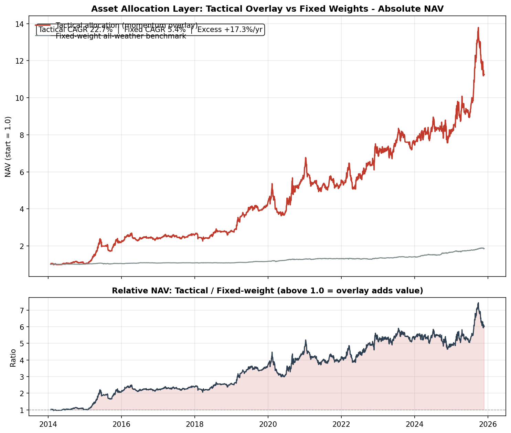
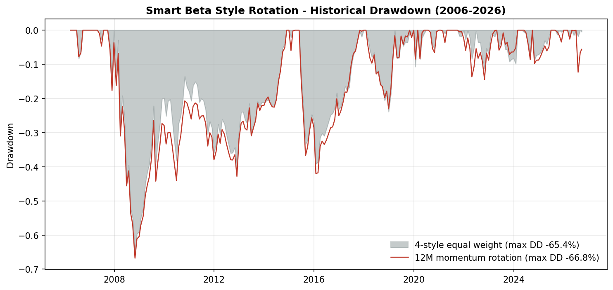
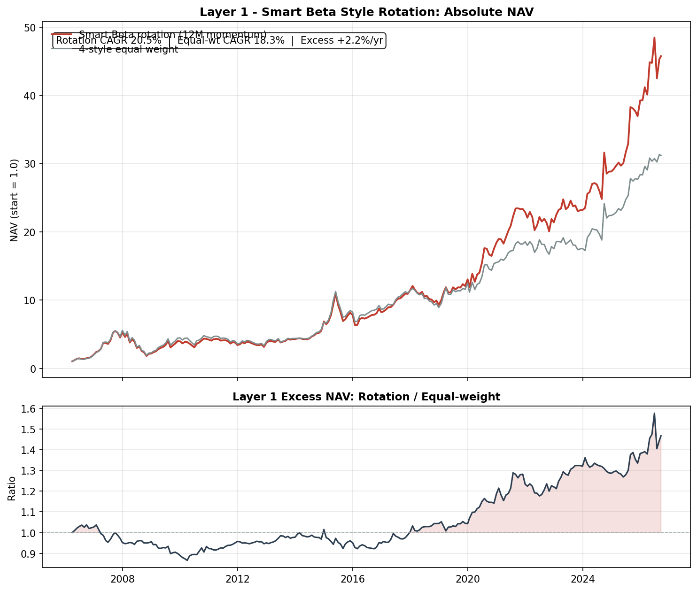
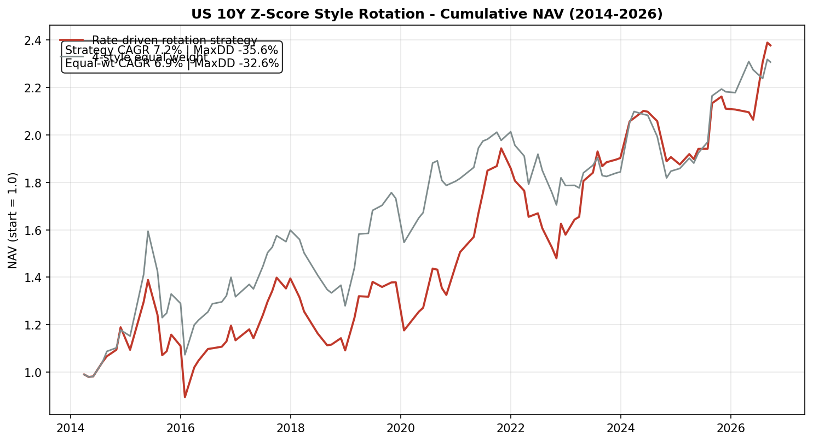
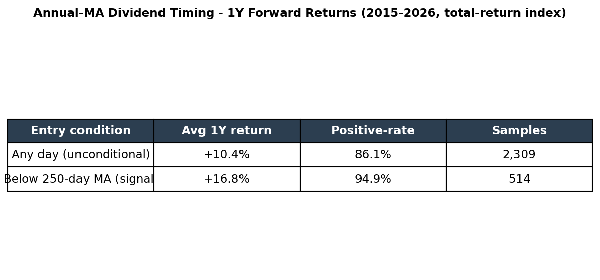
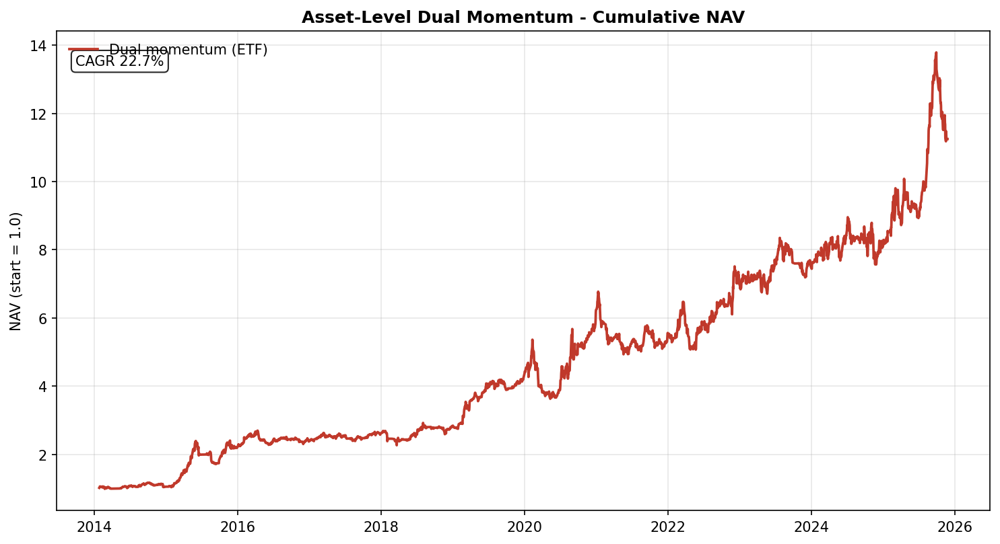

# Quant Allocation Lab

**Asset allocation · Style rotation · Timing models for China markets**

8+ years of live buy-side development · PKU M.Eng. CS · Python/pandas

  

---

# Block 1 · Asset Allocation

Tactical momentum overlay vs fixed all-weather weights (30Y CGB 30% / gold 15% / 10Y CGB 10% / equity styles 25% / commodities 25%), ETF universe, monthly rebalance.

### Annual Returns

| Year | Fixed-weight | Tactical overlay | Tactical MaxDD |
|---:|---:|---:|---:|
| 2014 | +0.7% | **+3.3%** | −11.0% |
| 2015 | +3.7% | **+111.3%** | −28.2% |
| 2016 | +2.3% | **+8.0%** | −15.4% |
| 2017 | +0.7% | **+9.0%** | −9.0% |
| 2018 | +0.1% | **+8.3%** | −15.6% |
| 2019 | +7.6% | **+52.8%** | −7.1% |
| 2020 | +10.5% | **+44.4%** | −32.3% |
| 2021 | +2.2% | −10.9% | −27.1% |
| 2022 | +1.1% | **+26.1%** | −21.6% |
| 2023 | +6.4% | **+7.2%** | −13.9% |
| 2024 | +16.9% | +7.6% | −15.5% |
| 2025 | +12.0% | **+39.0%** | −18.9% |
| **CAGR 11.8y** | 5.4% | **22.7%** | — |
| **Vol / Sharpe** | 4.3% / 1.26 | 21.3% / 1.06 | — |
| **MaxDD** | **−4.6%** | −32.3% | — |

Tactical wins 10 of 12 years; fixed book wins on risk-adjusted terms — complements, not substitutes.

### Historical Drawdown

### Cumulative NAV

---

# Block 2 · Smart Beta Style Rotation

Dividend / Growth / Quality / Value legs rotated by 12-month momentum, monthly. 20.5 years.

### Annual Returns

| Year | Equal-weight | Rotation | Year | Equal-weight | Rotation |
|---:|---:|---:|---:|---:|---:|
| 2006 | +88.9% | **+93.9%** | 2017 | +31.5% | **+39.0%** |
| 2007 | +185.1% | +164.3% | 2018 | −21.8% | **−18.5%** |
| 2008 | −59.1% | **−58.9%** | 2019 | +40.3% | +40.2% |
| 2009 | +95.8% | +82.2% | 2020 | +24.1% | **+41.4%** |
| 2010 | +2.4% | **+6.2%** | 2021 | +19.6% | **+24.2%** |
| 2011 | −21.9% | **−19.0%** | 2022 | −5.5% | −6.5% |
| 2012 | +10.7% | +9.9% | 2023 | +0.2% | **+8.4%** |
| 2013 | +11.1% | **+14.4%** | 2024 | +27.7% | +24.4% |
| 2014 | +54.7% | **+60.5%** | 2025 | +26.7% | **+36.1%** |
| 2015 | +21.4% | +13.8% | 2026 YTD | +9.8% | **+16.5%** |
| 2016 | +5.2% | +5.0% | **CAGR 20.5y** | 18.3% | **20.5%** |

Rotation wins 13 of 21 years; wins concentrate post-2016 (institutional era).

### Historical Drawdown

### Cumulative NAV & Excess

---

# Block 3 · Timing Models

Supporting single-asset timing models, each self-contained with methodology, backtest, and failure modes in the docstring.

| Model | Idea | Key stat |
|---|---|---|
| Annual-MA dividend rule | Buy below 250-day MA | **94.9%** 1Y win rate, avg +16.8% (514 samples) |
| Dual momentum (asset) | Absolute + relative momentum, cash fallback | CAGR 22.7% gross / 16.5–18.9% net |
| US 10Y rate Z-score | 3-regime style switch | +0.4%/yr excess; failure modes documented |
| Gold valuation | Price vs 5Y valuation band | Entry/exit discipline |
| LPPLS | Log-periodic bubble detection | Regime flagging |
| Bond futures timing | Trend filter on CGB futures | — |

Rate Z-score chart

Annual-MA table

Dual momentum NAV

---

> **Disclaimer:** Historical backtests on total-return indices; not a guarantee of future returns. Every model documents its own failure modes inline.

## Engineering Principles

1. **No look-ahead.** Rolling windows as-of; total-return indices where dividends matter.
2. **Honest attribution.** Fee drag, regime breaks, turnover costs documented, not hidden.
3. **Excel-lineage cross-checks** for spreadsheet-prototyped models.
4. **Institutional data hygiene.** Explicit index-code lineage per signal.

## Author

**Fucheng Dou** — fund manager (index & multi-asset), 9 years buy-side. PKU M.Eng. CS + B.Sc. Physics.
