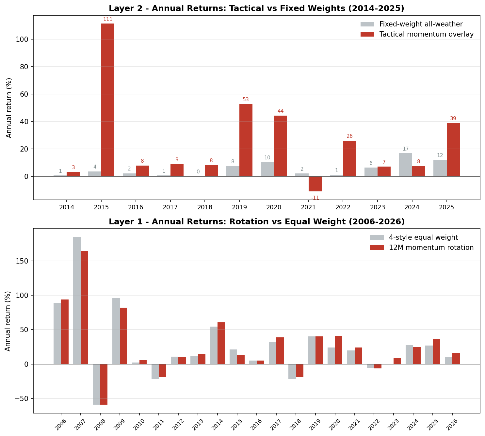

<div align="center">

# Quant Allocation Lab

**A two-layer quantitative investment system for China markets**

Layer 1 · Smart Beta style rotation → Layer 2 · Tactical asset allocation overlay

8+ years of live buy-side development · PKU M.Eng. CS · Python/pandas

  

</div>

---

## The Two-Layer Framework

```
┌─────────────────────────────────────────────────┐
│  Layer 2 · Asset Allocation Overlay             │
│  Momentum-gated tactical weights across         │
│  equity / bonds / commodities / gold ETFs       │
│  → beats fixed all-weather weights by +17%/yr   │
├─────────────────────────────────────────────────┤
│  Layer 1 · Smart Beta Style Rotation            │
│  Dividend / Growth / Quality / Value legs,      │
│  rotated by rate, momentum, cycle, crowding     │
│  → beats 4-style equal weight over 20 years     │
├─────────────────────────────────────────────────┤
│  Data · Wind total-return indices, no look-ahead│
└─────────────────────────────────────────────────┘
```

## Annual Returns — Layer by Layer



### Layer 2 · Tactical Allocation vs Fixed All-Weather Weights (2014–2025)

| Year | Fixed-weight | Tactical overlay | Tactical MaxDD |
|---:|---:|---:|---:|
| 2014 | +0.7% | **+3.3%** | −11.0% |
| 2015 | +3.7% | **+111.3%** | −28.2% |
| 2016 | +2.3% | **+8.0%** | −15.4% |
| 2017 | +0.7% | **+9.0%** | −9.0% |
| 2018 | +0.1% | **+8.3%** | −15.6% |
| 2019 | +7.6% | **+52.8%** | −7.1% |
| 2020 | +10.5% | **+44.4%** | −32.3% |
| 2021 | +2.2% | −10.9% | −27.1% |
| 2022 | +1.1% | **+26.1%** | −21.6% |
| 2023 | +6.4% | **+7.2%** | −13.9% |
| 2024 | +16.9% | +7.6% | −15.5% |
| 2025 | +12.0% | **+39.0%** | −18.9% |
| **CAGR** | 5.4% | **22.7%** | — |
| Volatility | 4.3% | 21.3% | — |
| Sharpe | 1.26 | 1.06 | — |
| MaxDD | −4.6% | −32.3% | — |

Fixed-weight book = classic all-weather (30Y CGB 30% / gold 15% / 10Y CGB 10% / equity styles 25% / commodities 25%). Tactical wins 10 of 12 years; fixed book wins on risk-adjusted terms — the two are complements, not substitutes.

### Layer 1 · Smart Beta Rotation vs Equal Weight (2006–2026)

| Year | Equal-weight | Rotation | Year | Equal-weight | Rotation |
|---:|---:|---:|---:|---:|---:|
| 2006 | +88.9% | **+93.9%** | 2017 | +31.5% | **+39.0%** |
| 2007 | +185.1% | +164.3% | 2018 | −21.8% | **−18.5%** |
| 2008 | −59.1% | **−58.9%** | 2019 | +40.3% | +40.2% |
| 2009 | +95.8% | +82.2% | 2020 | +24.1% | **+41.4%** |
| 2010 | +2.4% | **+6.2%** | 2021 | +19.6% | **+24.2%** |
| 2011 | −21.9% | **−19.0%** | 2022 | −5.5% | −6.5% |
| 2012 | +10.7% | +9.9% | 2023 | +0.2% | **+8.4%** |
| 2013 | +11.1% | **+14.4%** | 2024 | +27.7% | +24.4% |
| 2014 | +54.7% | **+60.5%** | 2025 | +26.7% | **+36.1%** |
| 2015 | +21.4% | +13.8% | 2026 YTD | +9.8% | **+16.5%** |
| 2016 | +5.2% | +5.0% | **CAGR 20.5y** | 18.3% | **20.5%** |

Rotation wins 13 of 21 years, and crucially the wins concentrate in post-2016 markets (institutional era) — early-year A-share beta dominates both legs.

---

## Cumulative Performance

### Layer 1 — Smart Beta Style Rotation


Top panel: absolute NAV. Bottom panel: cumulative excess vs equal weight. **Rotation CAGR 20.5% vs 18.3%** (+2.2%/yr, 20.5 years). Term-structure analysis in-model: 12M is the sweet spot (2–3M mean-reverts, 6–12M trends persist). Win rate 54.6%, turnover 7.9%/month.

### Layer 2 — Tactical Asset Allocation Overlay


**Tactical CAGR 22.7% vs fixed 5.4% — +17.3%/yr excess** over 11.8 years. Fee honesty in-model: 20.6% gross → 16.5–18.9% net.

### Supporting engines

- **US 10Y rate Z-score** (3-regime, 2014–2026): 
- **Annual-MA conditional entry** (94.9% win rate below MA): 
- Asset-level dual momentum: 

> **Disclaimer:** Historical backtests on total-return indices; not a guarantee of future returns. Every model documents its own failure modes (regime breaks, fee drag, turnover costs) inline — audit before you trust.

---

## Model Map

| Layer | Module | Models |
|---|---|---|
| 2 | `allocation/` | Risk-parity engine, all-weather fixed weights, momentum overlay |
| 1 | `style_rotation/` | Momentum (12M), rate Z-score, Pring 6-phase, valuation spread, crowding, pair-switch, alpha-composite, combined |
| 1 | `timing/` | Dual momentum, annual-MA rule, gold valuation, LPPLS bubbles, bond-futures timing, index valuation signal |

Every model opens with: **hypothesis → indicator → signal rules → backtest → failure modes** — auditable without running code.

## Engineering Principles

1. **No look-ahead.** Rolling windows as-of; total-return indices where dividends matter.
2. **Honest attribution.** Failure modes and fee drag documented, not hidden.
3. **Excel-lineage cross-checks** for models prototyped in spreadsheets first.
4. **Institutional data hygiene.** Explicit index-code lineage per signal.

## Author

**Fucheng Dou** — fund manager (index & multi-asset), 9 years buy-side. PKU M.Eng. CS + B.Sc. Physics.
